# Verification report (Phase 1: cases 1-5; Phase 2: cases 6-7)

## 1. Poiseuille channel (force-driven)

**f32**: tau = 0.8, residual-converged, backend cuda; order fitted over H <= 32 (fp32 round-off floor beyond; see poiseuille.py).

| Case | H (channel width) | L2 error | observed order |
|---|---|---|---|
| D3Q19-bgk-solid | [8, 16, 32, 64] | 1.11e-02, 2.76e-03, 6.58e-04, 8.05e-05 | **2.039** |
| D3Q19-rr-solid | [8, 16, 32, 64] | 4.28e-03, 1.07e-03, 2.51e-04, 1.40e-04 | **2.047** |
| D3Q27-bgk-solid | [8, 16, 32, 64] | 1.11e-02, 2.77e-03, 7.55e-04, 3.80e-04 | **1.941** |
| D3Q27-rr-solid | [8, 16, 32, 64] | 4.28e-03, 1.08e-03, 2.94e-04, 7.26e-05 | **1.931** |
| D3Q19-bgk-freeslip | [8, 16, 32, 64] | 1.11e-02, 2.77e-03, 6.89e-04, 8.11e-05 | **2.007** |
| D3Q19-rr-freeslip | [8, 16, 32, 64] | 4.28e-03, 1.07e-03, 2.57e-04, 1.36e-04 | **2.028** |
| D3Q27-bgk-freeslip | [8, 16, 32, 64] | 1.11e-02, 2.79e-03, 6.97e-04, 4.56e-04 | **1.998** |
| D3Q27-rr-freeslip | [8, 16, 32, 64] | 4.28e-03, 1.10e-03, 3.20e-04, 2.72e-04 | **1.870** |

BGK at tau = 1/2 + sqrt(3/16) (analytically exact), L2 error for N = 8, 16, 24, 32: D3Q19: 2.6e-06, 1.0e-05, 8.1e-07, 1.7e-05; D3Q27: 1.4e-06, 4.0e-06, 2.3e-05, 3.9e-05

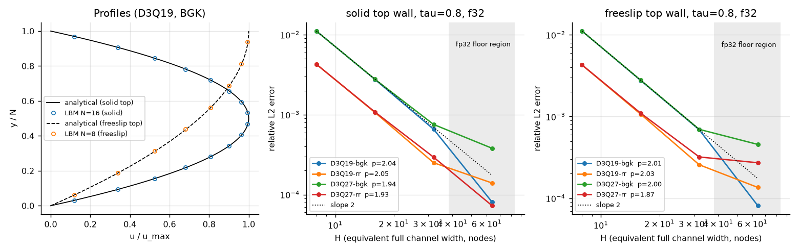

**f64**: tau = 0.8, residual-converged, backend cpu; all points fitted.

| Case | H (channel width) | L2 error | observed order |
|---|---|---|---|
| D3Q19-bgk-solid | [8, 16, 32, 64] | 1.11e-02, 2.78e-03, 6.95e-04, 1.74e-04 | **2.000** |
| D3Q19-rr-solid | [8, 16, 32, 64] | 4.28e-03, 1.07e-03, 2.67e-04, 6.69e-05 | **2.000** |
| D3Q27-rr-solid | [8, 16, 32, 64] | 4.28e-03, 1.07e-03, 2.67e-04, 6.69e-05 | **2.000** |
| D3Q19-bgk-freeslip | [8, 16, 32, 64] | 1.11e-02, 2.78e-03, 6.95e-04, 1.74e-04 | **2.000** |
| D3Q19-rr-freeslip | [8, 16, 32, 64] | 4.28e-03, 1.07e-03, 2.67e-04, 6.69e-05 | **2.000** |
| D3Q27-rr-freeslip | [8, 16, 32, 64] | 4.28e-03, 1.07e-03, 2.67e-04, 6.69e-05 | **2.000** |

BGK at tau = 1/2 + sqrt(3/16) (analytically exact), L2 error for N = 8, 16, 24, 32: D3Q19: 2.7e-09, 2.7e-09, 2.7e-09, 2.7e-09; D3Q27: 2.7e-09, 2.7e-09, 2.7e-09, 2.7e-09

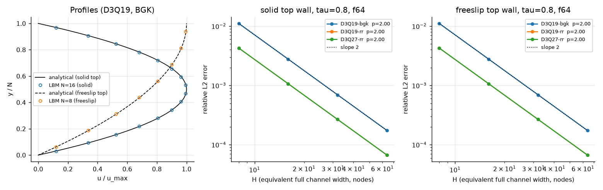

## 2. Lid-driven cavity vs Ghia et al. (1982)

| Re | N | lattice | collision | τ | steps | max dev /U | RMS dev /U | tolerance | pass |
|---|---|---|---|---|---|---|---|---|---|
| 100 | 128 | D3Q19 | bgk | 0.8840 | 33000 | 0.0060 | 0.0030 | 0.02 | ✅ |
| 100 | 128 | D3Q19 | rr | 0.8840 | 33000 | 0.0059 | 0.0029 | 0.02 | ✅ |
| 100 | 128 | D3Q27 | rr | 0.8840 | 56000 | 0.0059 | 0.0029 | 0.02 | ✅ |
| 1000 | 256 | D3Q19 | bgk | 0.5768 | 2000000 | 0.0095 | 0.0043 | 0.03 | ✅ |
| 1000 | 256 | D3Q19 | rr | 0.5768 | 2000000 | 0.0092 | 0.0042 | 0.03 | ✅ |
| 1000 | 256 | D3Q27 | rr | 0.5768 | 2000000 | 0.0090 | 0.0042 | 0.03 | ✅ |

Note: Re=1000 D3Q19 bgk, Re=1000 D3Q19 rr, Re=1000 D3Q27 rr stopped at the step cap with residual max|du|/U per 1000 steps = 3.4e-06, 6.0e-06, 5.5e-06 (target 1e-6).

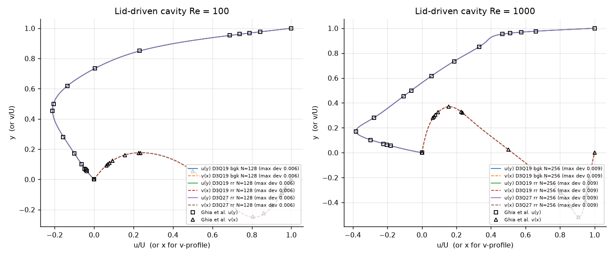

## 3. Cylinder, Re = 100

| lattice | collision | D (cells) | St (D) | St (D_eff) | cycles | period scatter | pass (0.16–0.17) |
|---|---|---|---|---|---|---|---|
| D3Q19 | bgk | 20 | **0.1685** | 0.1679 | 30 | 1.5e-03 | ✅ |
| D3Q19 | rr | 20 | **0.1683** | 0.1678 | 30 | 1.5e-03 | ✅ |
| D3Q27 | rr | 20 | **0.1683** | 0.1677 | 30 | 1.5e-03 | ✅ |

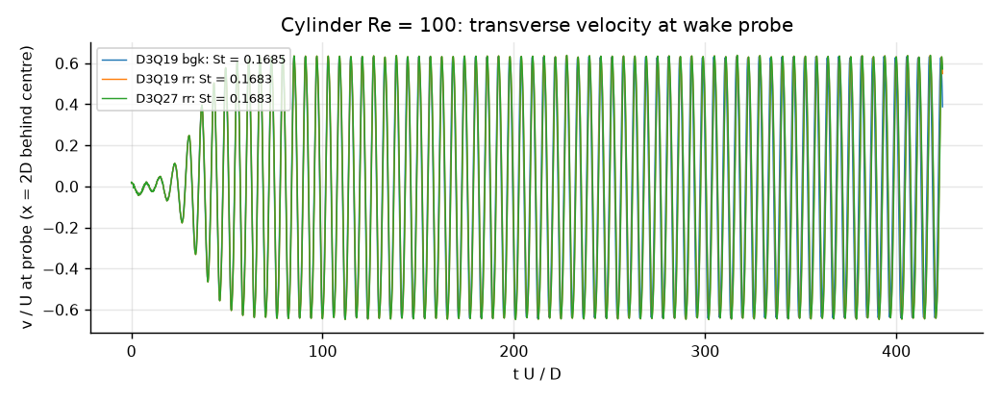

## 4. Turbulent round jet

Acceptance: B in [4.5, 6.7], S in [0.077, 0.112] (fit over 15 <= x/D <= 25). Experimental potential core: ~4-6 D.

| lattice | Cs | inflow disturbance | domain /D | fit window x/D | B | x0/D | S | potential core /D | J/J0 (5-25 D) | pass |
|---|---|---|---|---|---|---|---|---|---|---|
| D3Q19 | 0.1 | 0.05 | 30 | 15-25 | **5.21** | 2.50 | **0.1043** | 8.4 | 1.01–1.11 | ✅ |
| D3Q27 | 0.1 | 0.05 | 30 | 15-25 | **4.35** | 9.63 | **0.1259** | 14.2 | 1.00–1.20 | ❌ |
| D3Q19 | 0.1 | 0.15 | 30 | 15-25 | **5.40** | -0.68 | **0.0934** | 6.4 | 1.04–1.13 | ✅ |
| D3Q27 | 0.1 | 0.15 | 30 | 15-25 | **4.73** | 2.49 | **0.1125** | 8.7 | 1.00–1.18 | ❌ |
| D3Q27 | 0.1 | 0.05 | 45 | 25-40 | **5.69** | 4.72 | **0.0902** | 14.4 | 1.00–1.21 | ✅ |
| D3Q19 | 0.12 | 0.05 | 30 | 15-25 | **5.45** | 1.89 | **0.0953** | 8.7 | 1.01–1.12 | ✅ |
| D3Q27 | 0.12 | 0.05 | 30 | 15-25 | **4.10** | 11.76 | **0.1350** | 15.9 | 1.00–1.21 | ❌ |
| D3Q19 | 0.17 | 0.05 | 30 | 15-25 | **4.11** | 10.12 | **0.1367** | 12.8 | 1.00–1.07 | ❌ |
| D3Q27 | 0.17 | 0.05 | 30 | 15-25 | **54.48** | -34.37 | **0.0048** | 23.4 | 1.00–1.06 | ❌ |

Literature: Wygnanski & Fiedler 1969: B=5.0, S=0.086; Panchapakesan & Lumley 1993: B=6.06, S=0.096; Hussein et al. 1994 LDA: B=5.8, S=0.094; Hussein et al. 1994 HW: B=5.9, S=0.102

Interpretation (DECISIONS.md D-120): pass/fail in the 15-25 D window is governed by when the nozzle shear layer transitions (core <= ~9 D passes). D3Q27 transitions later than D3Q19 but its far field on a 45 D domain matches the literature (B = 5.69, S = 0.090).

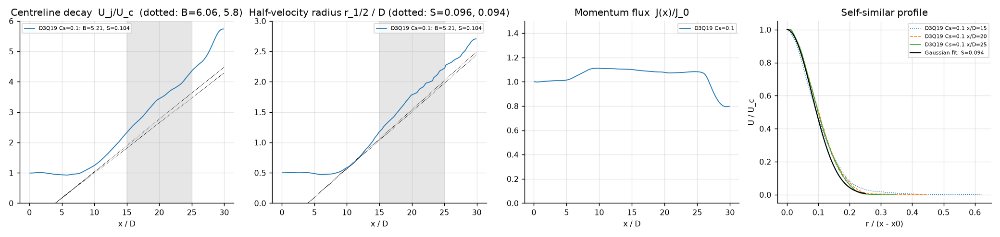
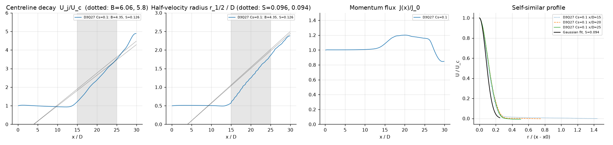
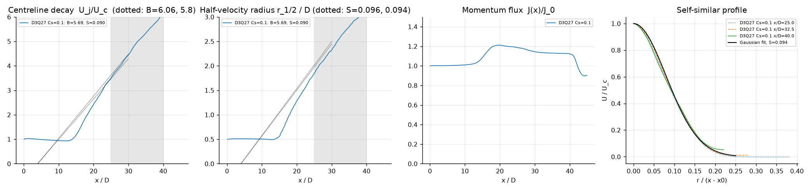
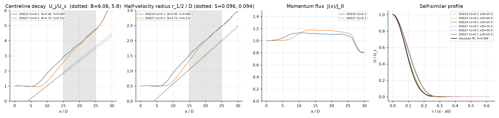
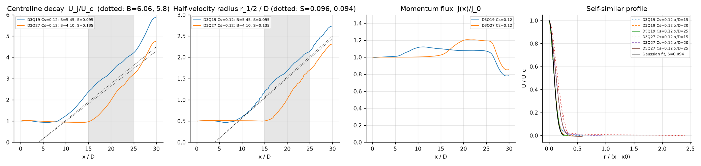
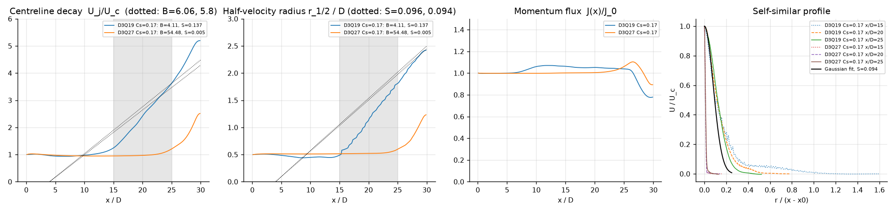

Initial run, Cs = 0.17, both lattices (before the half-width analysis fix: its r_1/2 and self-similarity panels are invalid). The centreline panel is valid and shows the laminar potential core persisting to ~12 D (D3Q19) and ~25 D (D3Q27): Cs = 0.17 over-damps the nozzle shear layer at D = 10 cells.

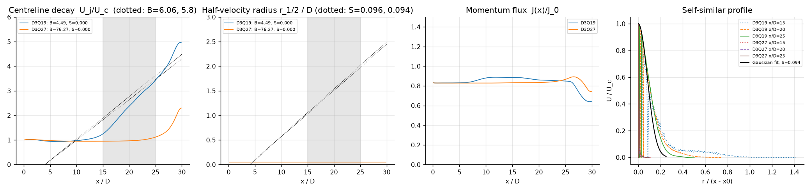

## 5. Closed box with momentum-source jet

| lattice | max mass drift | momentum-injection error | net/forward flux at planes | pass |
|---|---|---|---|---|
| D3Q19 | 2.1e-08 | 7.3e-08 | x=40: -3.2e-05, x=64: -3.3e-05, x=96: -3.8e-05 | ✅ |
| D3Q27 | 1.4e-08 | 2.4e-08 | x=40: -4.0e-05, x=64: -4.6e-05, x=96: 8.1e-06 | ✅ |

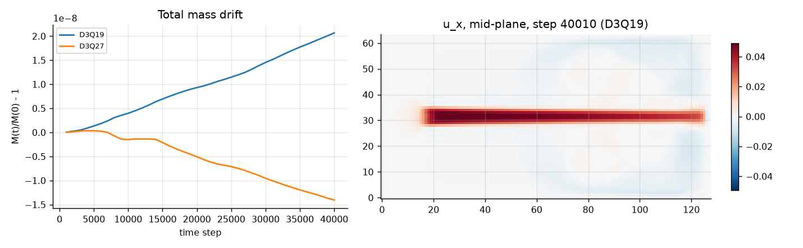

## 6. Grid-convergence study, demo 75-gallon tank

| run | dx | steps | wall time | MLUPS | mass drift | max lattice speed | KE 1st/2nd half of averaging |
|---|---|---|---|---|---|---|---|
| D3Q19 preview | 10 mm | 254580 | 5.8 min | 184 | 7.3e-07 | 0.125 | 113.9 / 111.0 cm²/s² |
| D3Q19 standard | 5 mm | 509150 | 12.6 min | 1297 | 1.7e-06 | 0.127 | 128.4 / 126.2 cm²/s² |
| D3Q19 fine | 3 mm | 848570 | 76.4 min | 1622 | 3.0e-06 | 0.138 | 133.0 / 133.9 cm²/s² |
| D3Q27 preview | 10 mm | 254580 | 7.1 min | 150 | 8.2e-07 | 0.128 | 115.2 / 111.0 cm²/s² |
| D3Q27 standard | 5 mm | 509150 | 25.6 min | 640 | 1.8e-06 | 0.130 | 128.6 / 128.4 cm²/s² |
| D3Q27 fine | 3 mm | 848570 | 91.9 min | 1348 | 3.1e-06 | 0.137 | 133.6 / 134.5 cm²/s² |

### D3Q19

| metric | Preview 10 mm | Standard 5 mm | Fine 3 mm | Δ P→S | Δ S→F | order p | GCI_fine | reading |
|---|---|---|---|---|---|---|---|---|
| volume-mean speed <|u|> [cm/s] | 10.85 ± 0.15 | 11.98 ± 0.14 | 12.57 ± 0.09 | +10.4 % | +5.0 % | 0.55 (monotonic) | 18.1 % | converged |
| median speed [cm/s] | 9.02 ± 0.23 | 10.06 ± 0.22 | 10.91 ± 0.15 | +11.5 % | +8.4 % | 0.24 (monotonic) | 73.9 % | converged |
| dead-zone volume (<|u|> below threshold) [%] | 6.58 ± 0.44 | 3.59 ± 0.18 | 2.45 ± 0.04 | -45.4 % | -31.8 % | 1.07 (monotonic) | 80.2 % | NOT converged |
| volume-mean RMS fluctuation sqrt(2k/3) [cm/s] | 5.08 ± 0.10 | 5.35 ± 0.10 | 5.71 ± 0.08 | +5.3 % | +6.6 % | 1.42 (monotonic) | 7.2 % | converged |
| speed 15 mm above rock tops [cm/s] | 4.29 ± 0.30 | 6.36 ± 0.12 | 8.12 ± 0.26 | +48.4 % | +27.6 % | 0.33 (monotonic) | 146.9 % | NOT converged |
| speed 15 mm above the sand [cm/s] | 3.71 ± 0.22 | 7.95 ± 0.11 | 9.79 ± 0.16 | +114.0 % | +23.2 % | 0.87 (monotonic) | 42.3 % | NOT converged |
| plan-plane mean speed at 25 % of the water column [cm/s] | 7.35 ± 0.31 | 8.92 ± 0.23 | 9.68 ± 0.16 | +21.4 % | +8.6 % | 0.68 (monotonic) | 23.9 % | converged |
| plan-plane mean speed at 50 % of the water column [cm/s] | 10.30 ± 0.29 | 11.11 ± 0.30 | 11.60 ± 0.17 | +8.0 % | +4.4 % | 0.36 (monotonic) | 25.6 % | converged |
| plan-plane mean speed at 75 % of the water column [cm/s] | 17.14 ± 0.32 | 17.88 ± 0.21 | 18.24 ± 0.11 | +4.3 % | +2.0 % | 0.65 (monotonic) | 6.3 % | converged |
| volume with <|u|> > 30 cm/s [%] | 2.73 ± 0.07 | 3.22 ± 0.04 | 3.20 ± 0.09 | +18.0 % | -0.6 % | — | S→F change < 2σ noise | converged |

### D3Q27

| metric | Preview 10 mm | Standard 5 mm | Fine 3 mm | Δ P→S | Δ S→F | order p | GCI_fine | reading |
|---|---|---|---|---|---|---|---|---|
| volume-mean speed <|u|> [cm/s] | 10.71 ± 0.26 | 11.93 ± 0.07 | 12.55 ± 0.08 | +11.4 % | +5.2 % | 0.62 (monotonic) | 16.6 % | converged |
| median speed [cm/s] | 8.70 ± 0.33 | 9.87 ± 0.12 | 10.72 ± 0.14 | +13.5 % | +8.6 % | 0.04 (monotonic) | 485.6 % | converged |
| dead-zone volume (<|u|> below threshold) [%] | 7.60 ± 0.52 | 4.27 ± 0.07 | 2.88 ± 0.06 | -43.9 % | -32.5 % | 0.94 (monotonic) | 97.8 % | NOT converged |
| volume-mean RMS fluctuation sqrt(2k/3) [cm/s] | 5.08 ± 0.10 | 5.38 ± 0.04 | 5.56 ± 0.09 | +5.9 % | +3.4 % | 0.33 (monotonic) | 22.3 % | converged |
| speed 15 mm above rock tops [cm/s] | 3.34 ± 0.18 | 5.72 ± 0.17 | 7.58 ± 0.12 | +71.3 % | +32.4 % | 0.13 (monotonic) | 446.0 % | NOT converged |
| speed 15 mm above the sand [cm/s] | 3.79 ± 0.25 | 8.16 ± 0.16 | 9.75 ± 0.36 | +115.2 % | +19.4 % | 1.16 (monotonic) | 25.1 % | NOT converged |
| plan-plane mean speed at 25 % of the water column [cm/s] | 7.27 ± 0.37 | 8.98 ± 0.06 | 9.50 ± 0.10 | +23.5 % | +5.8 % | 1.45 (monotonic) | 6.2 % | converged |
| plan-plane mean speed at 50 % of the water column [cm/s] | 9.91 ± 0.71 | 11.07 ± 0.21 | 11.48 ± 0.16 | +11.7 % | +3.7 % | 1.20 (monotonic) | 5.2 % | converged |
| plan-plane mean speed at 75 % of the water column [cm/s] | 16.46 ± 0.30 | 17.57 ± 0.18 | 18.33 ± 0.17 | +6.8 % | +4.3 % | 0.13 (monotonic) | 74.2 % | converged |
| volume with <|u|> > 30 cm/s [%] | 2.75 ± 0.10 | 3.26 ± 0.01 | 3.33 ± 0.06 | +18.3 % | +2.3 % | 2.57 (monotonic) | 1.0 % | converged |

Values are ± 2σ statistical (batch means). 'converged' = Standard→Fine change < 10 % or below 2σ statistical noise (pre-declared in gridstudy.py).

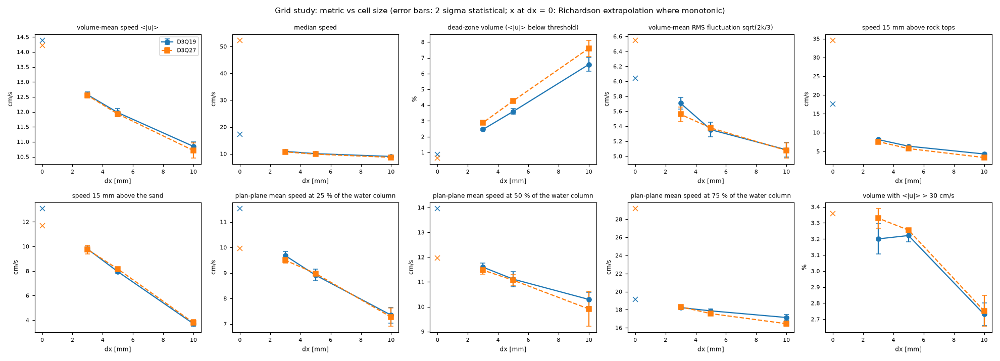

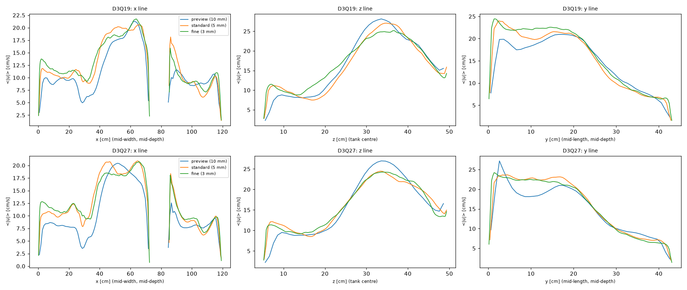

## 7. Pump sources: delivered jet momentum flux

Acceptance: 0.85 <= J(x)/J <= 1.2 for 3 <= x/D_eq <= 8. B, x0: round-jet law in momentum form fitted over 8-18 D_eq (literature B = 5.0-6.1).

| case | turbulence I | J/J (3-8 D) | J/J at 1 / 2 / 4 / 8 D | U_c/U_eq at 1 / 2 / 4 / 8 D | axis TI at 1 / 2 / 4 / 8 D | B | x0/D | pass |
|---|---|---|---|---|---|---|---|---|
| powerhead | 0.05 | 0.96–1.00 | 1.01 / 1.00 / 0.98 / 0.96 | 1.43 / 1.47 / 1.07 / 0.43 | 0.02 / 0.05 / 0.30 / 0.42 | 3.06 | 1.44 | ✅ |
| powerhead_I0 | 0 | 0.96–0.99 | 1.00 / 1.00 / 0.98 / 0.96 | 1.43 / 1.51 / 1.53 / 1.46 | 0.00 / 0.00 / 0.00 / 0.00 | 7.51 | 5.10 | ✅ |
| return | 0.05 | 0.95–1.01 | 1.00 / 1.01 / 0.99 / 0.96 | 1.11 / 1.12 / 0.92 / 0.43 | 0.02 / 0.03 / 0.23 / 0.39 | 4.12 | -2.37 | ✅ |
| powerhead_housing | 0.05 | 0.49–0.51 | 0.52 / 0.51 / 0.50 / 0.51 | 1.14 / 1.05 / 0.56 / 0.22 | 0.03 / 0.13 / 0.46 / 0.48 | 1.53 | 2.90 | — |

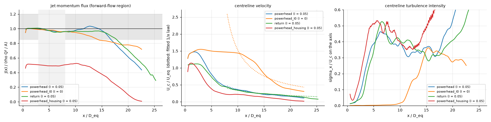

## 8. Turbulent channel flow: near-wall behaviour and the wall model (DECISIONS D-702)

Body-force-driven periodic channel: the wall shear is fixed at rho u_tau^2 by the momentum balance, and the flow it carries is compared with Dean's (1978) correlation. Pre-declared acceptance for the wall model: |U_b/u_tau - ref| <= 7 %. **Not met: the wall model diverged and is left off.** The bounce-back rows quantify the near-wall bias of production runs (ASSUMPTIONS A-310).

| case | first node y+ | U_b/u_tau | reference | error |
|---|---|---|---|---|
| Re_tau 2000, h = 16, bounce-back only | 62 | 10.89 | 21.7 | -50 % |
| Re_tau 2000, h = 16, wall model v1 (added viscosity only) | 62 | 10.85 | 21.7 | -50 % |
| Re_tau 2000, h = 16, wall model v2 (relaxation-time override) | 62 | diverged | 21.7 | — |
| Re_tau 2000, h = 32, bounce-back only | 31 | 12.84 | 21.7 | -41 % |
| Re_tau 500, h = 32, bounce-back only (tank-like y+) | 8 | 13.02 | 18.0 | -28 % |

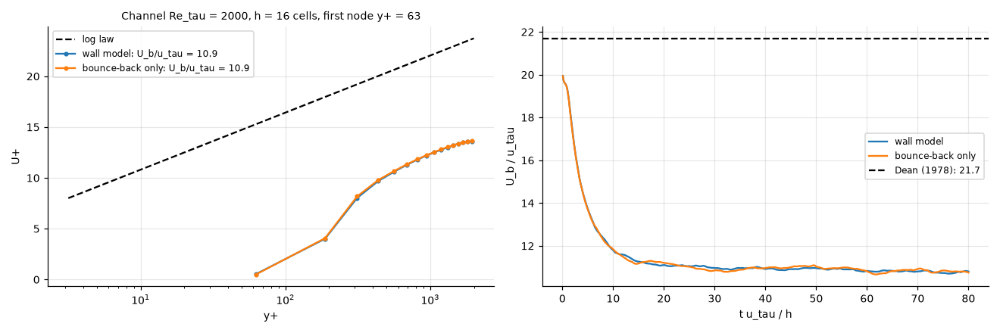

## 9. Lighting / PAR verification (Phase 4)

Acceptance criteria are in `reefflow/light/verification.py`; numbers in DECISIONS (Phase 4) and in each case's results.json and PNG.

| case | pass | results |
|---|---|---|
| Isotropic point source in air vs inverse square | ✅ | results/09_light/01_inverse_square/ |
| Lambertian panel vs analytic irradiance | ✅ | results/09_light/02_lambertian/ |
| Air-water and water-glass-air Fresnel / Snell / TIR vs analytic | ✅ | results/09_light/03_fresnel/ |
| Attenuation vs Beer-Lambert (collimated, diffuse, spectral) | ✅ | results/09_light/04_beer_lambert/ |
| Ray-count convergence (noise slope -1/2) | ✅ | results/09_light/05_convergence/ |
| Calibration round trip (recover a known fixture) | ✅ | results/09_light/06_calibration/ |
| Rock geometry: sphere interception, shadow, cosine law, normals | ✅ | results/09_light/07_sphere/ |
| Energy closure | ✅ | results/09_light/08_energy/ |

## 10. Photo reconstruction validation (Phase 6)

Synthetic photos of the demo rockscape rendered through the refraction model; criteria in `reefflow/photo/validation.py`. V1 fails its pre-declared IoU >= 0.70 (0.679, volume +47 %): silhouettes cannot see dips between rock blobs and hidden corner wedges, so the hull overfills (a fourth, oblique photo gives 0.705). Reconstructed volume is an upper bound; use the edit tools. Re-run 2026-11-03 with the outside-corner clicks and the texture mask cue (D-836 to D-839): same pass/fail, V3 mask IoU 0.988 / 0.997 / 0.998, voxel IoU 0.680. Re-run 2026-11-07 with the D-842 mask changes (speck filter on at this 1600 px size, bounded outline, sand rule): same pass/fail, V3 mask IoU 0.988 / 0.997 / 0.997, voxel IoU 0.679.

| case | pass |
|---|---|
| Camera recovery, exact clicks | ✅ |
| Camera recovery, 2 px click noise | ✅ |
| Carving, exact cameras + true masks (3 views) | ❌ |
| Carving, noisy calibration + true masks | ✅ |
| Full pipeline (noisy clicks + automatic segmentation) | ✅ |
| Click-noise sweep | ✅ |
| STL export round trip | ✅ |
| Cave restoration with the carve tool | ✅ |

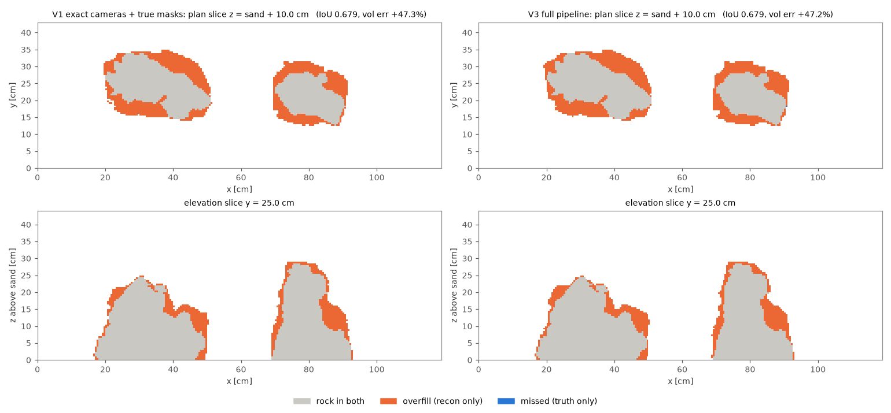

## Precision check: fp32 vs fp64 on the demo tank (ASSUMPTIONS A-109)

Preview grid, D3Q19. Turbulent runs decorrelate whatever the precision, so the fp64 - fp32 difference is judged against the seed-to-seed difference of two fp32 runs and the 2σ statistical noise (pre-declared in precision.py).

| metric | fp32 seed 1 | fp32 seed 2 | fp64 seed 1 | |seed diff| | |fp64 − fp32| | 2σ noise | immaterial |
|---|---|---|---|---|---|---|---|
| volume-mean speed <|u|> [cm/s] | 10.85 | 10.64 | 10.84 | 0.21 | 0.00 | 0.26 | yes |
| median speed [cm/s] | 9.02 | 8.80 | 9.04 | 0.22 | 0.01 | 0.41 | yes |
| dead-zone volume (<|u|> below threshold) [%] | 6.58 | 6.89 | 6.49 | 0.32 | 0.09 | 0.58 | yes |
| volume-mean RMS fluctuation sqrt(2k/3) [cm/s] | 5.08 | 5.08 | 4.99 | 0.01 | 0.09 | 0.10 | yes |
| speed 15 mm above rock tops [cm/s] | 4.29 | 4.13 | 4.21 | 0.16 | 0.08 | 0.41 | yes |
| speed 15 mm above the sand [cm/s] | 3.71 | 3.83 | 3.76 | 0.11 | 0.05 | 0.22 | yes |
| plan-plane mean speed at 25 % of the water column [cm/s] | 7.35 | 7.19 | 7.37 | 0.16 | 0.02 | 0.35 | yes |
| plan-plane mean speed at 50 % of the water column [cm/s] | 10.30 | 9.82 | 10.08 | 0.47 | 0.22 | 0.52 | yes |
| plan-plane mean speed at 75 % of the water column [cm/s] | 17.14 | 17.02 | 17.29 | 0.12 | 0.14 | 0.38 | yes |
| volume with <|u|> > 30 cm/s [%] | 2.73 | 2.67 | 2.75 | 0.06 | 0.02 | 0.08 | yes |

Round-off immaterial for every metric: **yes**.
