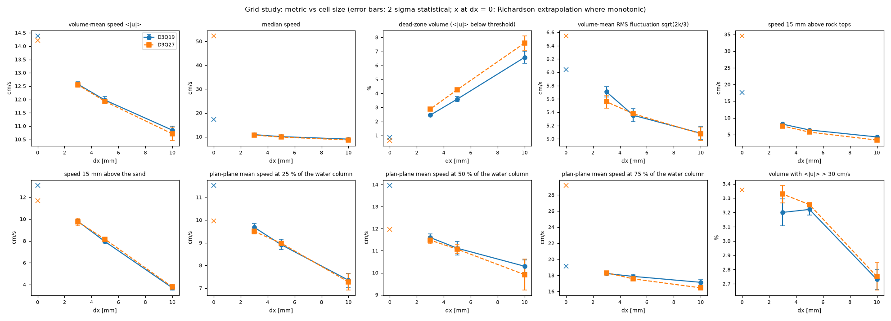
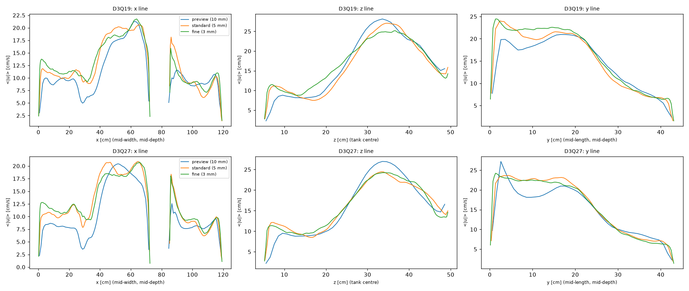

# Verification 6: grid-convergence study (demo 75-gal tank)

| run | dx | steps | wall time | MLUPS | mass drift | max lattice speed | KE 1st/2nd half of averaging |
|---|---|---|---|---|---|---|---|
| D3Q19 preview | 10 mm | 254580 | 5.8 min | 184 | 7.3e-07 | 0.125 | 113.9 / 111.0 cm²/s² |
| D3Q19 standard | 5 mm | 509150 | 12.6 min | 1297 | 1.7e-06 | 0.127 | 128.4 / 126.2 cm²/s² |
| D3Q19 fine | 3 mm | 848570 | 76.4 min | 1622 | 3.0e-06 | 0.138 | 133.0 / 133.9 cm²/s² |
| D3Q27 preview | 10 mm | 254580 | 7.1 min | 150 | 8.2e-07 | 0.128 | 115.2 / 111.0 cm²/s² |
| D3Q27 standard | 5 mm | 509150 | 25.6 min | 640 | 1.8e-06 | 0.130 | 128.6 / 128.4 cm²/s² |
| D3Q27 fine | 3 mm | 848570 | 91.9 min | 1348 | 3.1e-06 | 0.137 | 133.6 / 134.5 cm²/s² |

### D3Q19

| metric | Preview 10 mm | Standard 5 mm | Fine 3 mm | Δ P→S | Δ S→F | order p | GCI_fine | reading |
|---|---|---|---|---|---|---|---|---|
| volume-mean speed <|u|> [cm/s] | 10.85 ± 0.15 | 11.98 ± 0.14 | 12.57 ± 0.09 | +10.4 % | +5.0 % | 0.55 (monotonic) | 18.1 % | converged |
| median speed [cm/s] | 9.02 ± 0.23 | 10.06 ± 0.22 | 10.91 ± 0.15 | +11.5 % | +8.4 % | 0.24 (monotonic) | 73.9 % | converged |
| dead-zone volume (<|u|> below threshold) [%] | 6.58 ± 0.44 | 3.59 ± 0.18 | 2.45 ± 0.04 | -45.4 % | -31.8 % | 1.07 (monotonic) | 80.2 % | NOT converged |
| volume-mean RMS fluctuation sqrt(2k/3) [cm/s] | 5.08 ± 0.10 | 5.35 ± 0.10 | 5.71 ± 0.08 | +5.3 % | +6.6 % | 1.42 (monotonic) | 7.2 % | converged |
| speed 15 mm above rock tops [cm/s] | 4.29 ± 0.30 | 6.36 ± 0.12 | 8.12 ± 0.26 | +48.4 % | +27.6 % | 0.33 (monotonic) | 146.9 % | NOT converged |
| speed 15 mm above the sand [cm/s] | 3.71 ± 0.22 | 7.95 ± 0.11 | 9.79 ± 0.16 | +114.0 % | +23.2 % | 0.87 (monotonic) | 42.3 % | NOT converged |
| plan-plane mean speed at 25 % of the water column [cm/s] | 7.35 ± 0.31 | 8.92 ± 0.23 | 9.68 ± 0.16 | +21.4 % | +8.6 % | 0.68 (monotonic) | 23.9 % | converged |
| plan-plane mean speed at 50 % of the water column [cm/s] | 10.30 ± 0.29 | 11.11 ± 0.30 | 11.60 ± 0.17 | +8.0 % | +4.4 % | 0.36 (monotonic) | 25.6 % | converged |
| plan-plane mean speed at 75 % of the water column [cm/s] | 17.14 ± 0.32 | 17.88 ± 0.21 | 18.24 ± 0.11 | +4.3 % | +2.0 % | 0.65 (monotonic) | 6.3 % | converged |
| volume with <|u|> > 30 cm/s [%] | 2.73 ± 0.07 | 3.22 ± 0.04 | 3.20 ± 0.09 | +18.0 % | -0.6 % | — | S→F change < 2σ noise | converged |

### D3Q27

| metric | Preview 10 mm | Standard 5 mm | Fine 3 mm | Δ P→S | Δ S→F | order p | GCI_fine | reading |
|---|---|---|---|---|---|---|---|---|
| volume-mean speed <|u|> [cm/s] | 10.71 ± 0.26 | 11.93 ± 0.07 | 12.55 ± 0.08 | +11.4 % | +5.2 % | 0.62 (monotonic) | 16.6 % | converged |
| median speed [cm/s] | 8.70 ± 0.33 | 9.87 ± 0.12 | 10.72 ± 0.14 | +13.5 % | +8.6 % | 0.04 (monotonic) | 485.6 % | converged |
| dead-zone volume (<|u|> below threshold) [%] | 7.60 ± 0.52 | 4.27 ± 0.07 | 2.88 ± 0.06 | -43.9 % | -32.5 % | 0.94 (monotonic) | 97.8 % | NOT converged |
| volume-mean RMS fluctuation sqrt(2k/3) [cm/s] | 5.08 ± 0.10 | 5.38 ± 0.04 | 5.56 ± 0.09 | +5.9 % | +3.4 % | 0.33 (monotonic) | 22.3 % | converged |
| speed 15 mm above rock tops [cm/s] | 3.34 ± 0.18 | 5.72 ± 0.17 | 7.58 ± 0.12 | +71.3 % | +32.4 % | 0.13 (monotonic) | 446.0 % | NOT converged |
| speed 15 mm above the sand [cm/s] | 3.79 ± 0.25 | 8.16 ± 0.16 | 9.75 ± 0.36 | +115.2 % | +19.4 % | 1.16 (monotonic) | 25.1 % | NOT converged |
| plan-plane mean speed at 25 % of the water column [cm/s] | 7.27 ± 0.37 | 8.98 ± 0.06 | 9.50 ± 0.10 | +23.5 % | +5.8 % | 1.45 (monotonic) | 6.2 % | converged |
| plan-plane mean speed at 50 % of the water column [cm/s] | 9.91 ± 0.71 | 11.07 ± 0.21 | 11.48 ± 0.16 | +11.7 % | +3.7 % | 1.20 (monotonic) | 5.2 % | converged |
| plan-plane mean speed at 75 % of the water column [cm/s] | 16.46 ± 0.30 | 17.57 ± 0.18 | 18.33 ± 0.17 | +6.8 % | +4.3 % | 0.13 (monotonic) | 74.2 % | converged |
| volume with <|u|> > 30 cm/s [%] | 2.75 ± 0.10 | 3.26 ± 0.01 | 3.33 ± 0.06 | +18.3 % | +2.3 % | 2.57 (monotonic) | 1.0 % | converged |

Values are ± 2σ statistical (batch means). 'converged' = Standard→Fine change < 10 % or below 2σ statistical noise (pre-declared in gridstudy.py).

